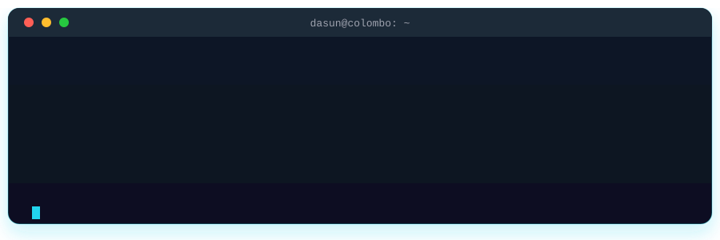
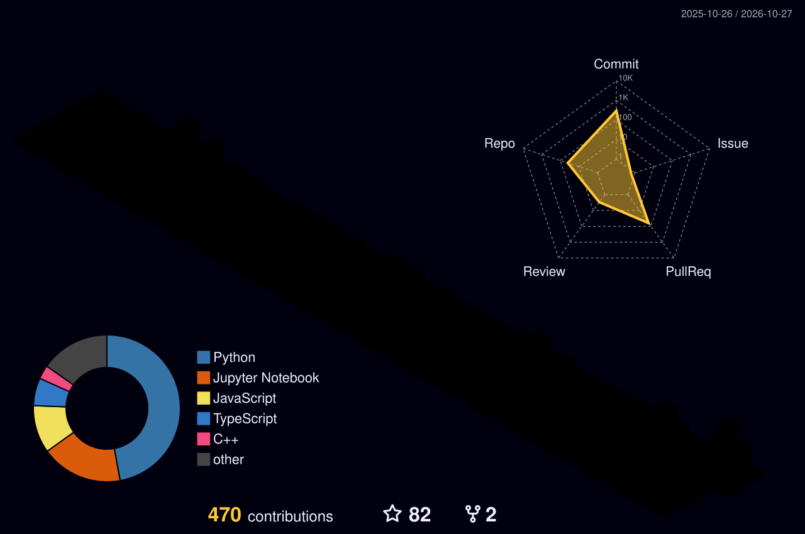

 

## 👨‍💻 About Me

I'm a **Software Engineering undergraduate from Colombo, Sri Lanka**, building secure, scalable and intelligent systems. I work across the stack, from **cloud-native microservices and GitOps pipelines** to **machine learning for security**.

- 🔭 Working on **explainable (XAI) commit-level vulnerability detection for DevSecOps pipelines**
- 🧠 Learning **Generative AI & LLMs**
- ☁️ Building and deploying on **Kubernetes, AWS EKS, Docker, Argo CD**
- 🤝 Open source contributor at **[@CIESYS](https://github.com/CIESYS)** and **[@typesense](https://github.com/typesense)**
- 📫 Reach me: **ddswilathgamuwa@gmail.com**

## 🛠️ Tech Stack

  

  

  

  

## 🧊 Contributions in 3D

## 🐍 Contribution Snake

<picture>
  <source media="(prefers-color-scheme: dark)" srcset="https://raw.githubusercontent.com/Ddasunsandeepa/Ddasunsandeepa/output/snake-dark.svg" />
  <source media="(prefers-color-scheme: light)" srcset="https://raw.githubusercontent.com/Ddasunsandeepa/Ddasunsandeepa/output/snake.svg" />
  
</picture>

## 📊 GitHub Analytics

 

## 🤝 Let's Connect

I'm open to collaborating on **DevOps, cloud-native, DevSecOps and AI security** projects.

